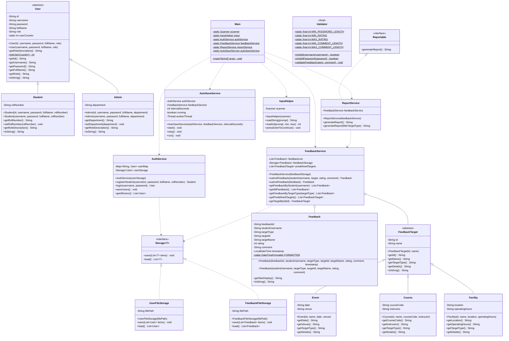

# Class Diagram - Campus Feedback System

Below is the architectural and object-oriented class diagram for the Campus Feedback System, illustrating class hierarchies, interfaces, relationships, and encapsulation boundaries.

