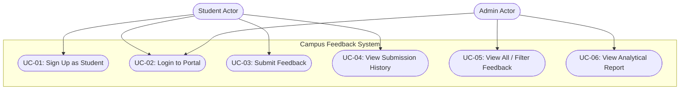

# Software Requirements Specification (SRS)
## Project: Campus Feedback System
**Course:** Software Engineering & Object-Oriented Programming Lab Record  
**Target Platform:** Java SE 17+ (Core Java, Zero External Libraries)

---

## 1. Introduction and Scope
The **Campus Feedback System** is a lightweight, console-driven academic application designed to collect, evaluate, and analyze student feedback on various campus entities (Events, Academic Courses, and Campus Facilities). 

The software enables students to share structured feedback and allows campus administrators to review submissions, categorize opinions, and generate aggregate statistical reports to identify top-performing and underperforming targets without requiring external database engines or third-party frameworks.

---

## 2. Stakeholders & User Roles
The system specifies two primary user roles with strictly segregated privileges:
1. **Student:**
   - Registers for a personal account with a unique username, password, full name, and roll number.
   - Authenticates into the student portal.
   - Reviews predefined campus targets organized by category.
   - Submits ratings (1–5 stars) and descriptive comments (5–300 characters).
   - Views personal submission history sorted in reverse chronological order (newest first).
2. **Admin (Campus Administrator):**
   - Automatically provisioned on first launch (`admin` / `admin123`).
   - Authenticates into the admin dashboard.
   - Inspects all feedback submissions across all campus targets.
   - Filters feedback records by target category (Events, Courses, Facilities).
   - Generates an analytical summary report displaying counts, overall rating average, per-target breakdown, and highest/lowest rated highlights.

---

## 3. Functional Requirements (FR)

### FR-1: Student Registration
- The system shall allow new students to register by providing a username, password, full name, and roll number.
- The system shall reject duplicate usernames with `DuplicateUserException`.
- Passwords must contain a minimum of 6 characters.

### FR-2: User Authentication
- The system shall authenticate both Students and Administrators against stored credentials.
- Incorrect credentials shall throw `InvalidLoginException`.
- The system shall route authenticated users strictly to their role-specific dashboard.

### FR-3: Default Administrator Provisioning
- Upon initial startup, if no administrator account exists in storage, the system shall automatically create a default admin profile (`username: admin`, `password: admin123`, `department: Campus Administration`).

### FR-4: Predefined Feedback Targets
- The system shall provide predefined, immutable targets categorized as follows:
  - **Events:** `Tech Fest 2026`, `Sports Day 2026`, `Cultural Night`, `Hack-the-Cloud Hackathon`.
  - **Courses:** `Cloud Computing (CS401)`, `Data Structures & Algorithms (CS201)`, `Machine Learning & AI (CS450)`, `Database Management Systems (CS302)`.
  - **Facilities:** `Central Library`, `Hostel Mess & Dining`, `Campus Wi-Fi Network`, `Student Sports Complex`.

### FR-5: Feedback Validation & Submission
- The student shall submit a star rating between 1 and 5 (inclusive).
- The student shall provide a text comment between 5 and 300 characters.
- Failure to comply with rating or comment rules shall throw `InvalidFeedbackException`.

### FR-6: 24-Hour Duplication Prevention
- A student shall not submit more than one feedback entry for the same target within any 24-hour window.
- Violations shall trigger a `DuplicateFeedbackException` detailing hours elapsed and remaining.

### FR-7: Student History Inspection
- Students shall be able to view all past feedbacks submitted by their account.
- History entries must be sorted descending by timestamp (newest submissions first) using `java.util.Comparator`.

### FR-8: Categorical Feedback Filtering
- Administrators shall be able to inspect all feedback records or filter records by category (`Event`, `Course`, `Facility`).

### FR-9: Statistical Summary & Analytics
- Administrators shall be able to generate an analytical summary report implementing the `Reportable` interface.
- The report shall compute:
  - Total feedback count.
  - Overall campus rating average.
  - Per-target feedback breakdown (target name, ID, type, submission count, average rating).
  - Target performance highlights: Highest rated target and Lowest rated target.

### FR-10: Persistence & Background Auto-Save
- All user and feedback data shall be persisted in plain text CSV files (`data/users.csv` and `data/feedback.csv`).
- A background daemon thread (`AutoSaveService`) shall periodically flush in-memory data to disk every 30 seconds and cleanly terminate upon system exit.

---

## 4. Non-Functional Requirements (NFR)

| ID | Category | Requirement Description |
|---|---|---|
| **NFR-1** | **Portability** | 100% Core Java (JDK 17+). Requires no external JARs, Maven, or Gradle plugins. Runs on any OS with a standard Java runtime. |
| **NFR-2** | **Usability** | Interactive console menu-driven UI using `java.util.Scanner` and `InputHelper`. Non-crashing input validation for letters entered into numeric menus. |
| **NFR-3** | **Reliability** | Deterministic resource management using `try-with-resources`. Guaranteed file save via JVM shutdown hooks and `finally` blocks. |
| **NFR-4** | **Performance** | In-memory `HashMap` caching allows $O(1)$ user authentication and fast aggregated statistical calculations. |
| **NFR-5** | **Maintainability** | Clean separation of concerns into 6 packages (`model`, `service`, `storage`, `exception`, `util`, `main`). |
| **NFR-6** | **Thread Safety** | Auto-save background thread executes as a daemon thread and uses synchronization on critical sections. |

---

## 5. Use Case Descriptions

### Detailed Use Case: UC-03 (Submit Target Feedback)
- **Primary Actor:** Student
- **Preconditions:** Student is authenticated.
- **Main Flow:**
  1. Student selects "Submit Feedback" from the Student Portal.
  2. Student selects category (1: Event, 2: Course, 3: Facility).
  3. System displays available targets with IDs and metadata.
  4. Student selects target index.
  5. Student inputs rating (1–5).
  6. Student inputs comment (5–300 characters).
  7. System validates rating, comment length, and checks that no feedback was submitted for this target by this student within the previous 24 hours.
  8. System saves the feedback with reference ID, timestamp, and visual stars.
  9. System displays success confirmation.
- **Alternative Flow (Validation Failure):**
  - If rating is outside 1–5 or comment is < 5 or > 300 characters, system throws `InvalidFeedbackException` and prompts to retry.
- **Alternative Flow (24-Hour Duplication):**
  - If student reviewed this target within 24 hours, system throws `DuplicateFeedbackException` indicating hours remaining.

